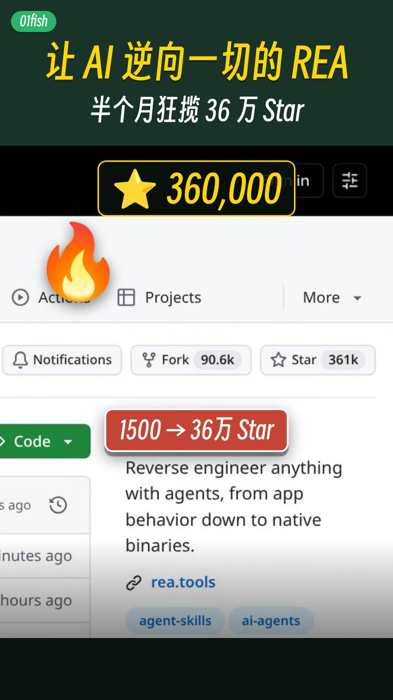

<div align="center">

# fish-video-cut

[English](README_EN.md) | **中文**

[](https://github.com/OrangeViolin/fish-video-cut/stargazers)
[](LICENSE)
[](SKILL.md)

**01fish 口播 / 录屏成片流水线。**

把原片交给 Cursor Agent，按固定步骤剪成可以发布的成片。<br>
它是一份 Agent Skill，仓库里的脚本也可以单独跑。

它不是视频生成模型。精剪、片头、打码、字幕和发布检查都是确定的步骤，画面来自你自己的原片。

</div>

## 样片

两条 01fish 成片的封面，各配 12 秒预览。点击封面播放。

<div align="center">

<a href="assets/demos/ep01-rea-preview.mp4"></a>
&nbsp;&nbsp;
<a href="assets/demos/ep-bot-tutorial-preview.mp4"></a>

<br><br>

<a href="assets/demos/ep01-rea-preview.mp4"><b>AI 前沿资讯 EP.01 · REA</b></a>
&nbsp;·&nbsp;
<a href="assets/demos/ep-bot-tutorial-preview.mp4"><b>一人公司 Bot 教程</b></a>

<br>

12 秒预览

</div>

## 它做什么

对 Cursor Agent 说一句「把这条口播剪成可以发的成片」。Agent 会按 [SKILL.md](SKILL.md) 建工作目录、精剪、接片头和 BGM、打码、烧字幕、出封面，质检之后把预览交给你。你确认了，才去发布。

**流程**

1. **精剪** — 用 silencedetect 加转写，去掉口误、重复和长停顿，剪辑点记到 `edl.md`
2. **片头 / BGM** — 约 5 秒品牌片头，与正片 0.25 秒交叉淡化；人声处 ducking。片头可接 [video-shotcraft](https://github.com/Vincentwei1021/video-shotcraft)
3. **打码** — 后台数据逐帧跟踪，高斯模糊加 16px 马赛克，再抽帧复核
4. **字幕** — 风格 B「干净科技」：大号白字、墨绿底条、逐字高亮、关键词色块、贴纸。风格 A 可选
5. **封面** — 3:4 `1080×1440`，另备 16:9 `1920×1080`。人脸用真实视频帧
6. **质检** — 片头、打码段、字幕密集段各抽帧
7. **发布** — 视频号与小红书。每一步等本人确认

## 安装

最简单的方式是把仓库链接丢给你的 agent：

```text
帮我安装这个 skill：https://github.com/OrangeViolin/fish-video-cut
```

或者手动安装：

```bash
git clone https://github.com/OrangeViolin/fish-video-cut.git
cd fish-video-cut
mkdir -p ~/.cursor/skills
ln -s "$(pwd)" ~/.cursor/skills/fish-video-cut
```

要自己跑脚本，再准备 Python 3.10+ 和 [FFmpeg](https://ffmpeg.org/)（含 `ffprobe`）：

```bash
python -m venv .venv
source .venv/bin/activate   # Windows: .venv\Scripts\activate
pip install -r requirements.txt
```

转写建议另装 [faster-whisper](https://github.com/SYSTRAN/faster-whisper) `large-v3`（`requirements.txt` 里已注释）。片头音源不在本仓库，见下方品牌一节。

## 使用

直接描述你要的成片就行，不需要先记命令。

| 你说 | 会发生什么 |
| --- | --- |
| `把这条口播剪成可以发视频号的成片。` | Agent 按 SKILL.md 建 `video-XX/`，精剪、接片头、打码、烧字幕、出封面，发布前把预览交给你确认 |
| `这段录屏里的后台数据打码。` | 用 `scripts/mosaic` 逐帧跟踪气泡，高斯模糊加 16px 马赛克，再抽帧核对 |
| `按风格 B 烧字幕，片头 5 秒。` | 读取文案和转写，`--offset 4.75`，烧到 `final/final.mp4` |
| `给这支片配 01fish 片头和 BGM。` | 参考 `scripts/mix/build_mix.py`：约 5 秒片头，人声处 ducking，响度约 −14 LUFS |

<details>
<summary>自己跑脚本</summary>

在仓库根目录执行。每条视频一个目录，原片放 `raw.mp4`。换片时设置 `FISH_VIDEO`（默认 `video-01`）。

```bash
mkdir -p video-01/{out,final}
# 原片放到 video-01/raw.mp4

python scripts/mosaic/track_bubble.py \
  --video video-01/out/cut.mp4 \
  --out video-01/out/track.json

python scripts/mosaic/apply_mosaic.py \
  --video video-01/out/cut.mp4 \
  --track video-01/out/track.json \
  --audio-from video-01/out/cut.mp4 \
  --out-nosub video-01/out/mosaic.mp4

# 5 秒片头、0.25 秒交叉淡化时 --offset 为 4.75；没有片头用 0
python scripts/subs/subs.py burn --style B \
  --input video-01/out/mosaic.mp4 \
  --output video-01/final/final.mp4 \
  --offset 4.75
```

字幕脚本按这个顺序找文件：

| 文件 | 优先 | 回退 |
| --- | --- | --- |
| 逐句文案 | `$FISH_VIDEO/cues.txt` | `scripts/subs/cues.txt` |
| 贴纸 | `$FISH_VIDEO/stickers.json` | `scripts/subs/stickers.json` |
| 转写 | `$FISH_VIDEO/out/transcript.json` | `scripts/out/transcript.json` |
| 剪辑点 | `$FISH_VIDEO/out/edl.md` | `scripts/out/edl.md` |

混音示例带有一条成片的时间点，换片时改脚本里的剪辑点和音效。音源目录用 `SHOTCRAFT_AUDIO`（默认 `assets/audio`，本仓库不附带）：

```bash
export SHOTCRAFT_AUDIO=/path/to/video-shotcraft/assets/audio
python scripts/mix/build_mix.py both
```

`.gitignore` 已忽略工作目录里的成片（`video-*/`、`out/`、`final/`，以及 `assets/demos/` 以外的 `*.mp4`）。

</details>

## 你会拿到什么

| 产出 | 说明 |
| --- | --- |
| 成片 | `$FISH_VIDEO/final/final.mp4`，含片头、打码和字幕 |
| 无字幕底片 | `$FISH_VIDEO/out/final-nosub.mp4` |
| 封面 | 3:4 `1080×1440`，另备 16:9 `1920×1080` |
| 质检抽帧 | `$FISH_VIDEO/final/qc-*.jpg`，片头、打码段、字幕密集段 |
| 可复用脚本 | 打码、字幕烧录、片头混音示例，见 `scripts/` |

## 品牌

| 项 | 值 |
| --- | --- |
| 墨绿 | `#1A3328` |
| 鱼红 | `#C44536` |
| 宣纸 | `#F2EDE3` |
| 默认 BGM | Mixkit「House Vibez」(Lily J)。正片人声处 ducking，响度约 −14 LUFS，true peak 不超过 −1 dBTP。本仓库不附音源 |
| 字体 | 字幕 Noto Sans CJK SC Black；封面得意黑（Smiley Sans）。文件在 `scripts/subs/fonts/` |
| 封面 | 3:4 `1080×1440`，另备 16:9 `1920×1080`。人脸用真实视频帧 |

<div align="center">


</div>

## 发布检查清单

- [ ] 视频号：3:4 封面，勾选「声明原创」；位置勿误填
- [ ] 小红书：打开原创声明；内容类型声明只能选一项，选「笔记含AI合成内容」
- [ ] 发布前由本人确认。先看预览，确认后再点发表，只点一次，然后到作品列表核对状态

## 仓库结构

```text
fish-video-cut/
├── SKILL.md                     # Cursor skill：完整流水线
├── README.md                    # 中文说明（本文件）
├── README_EN.md                 # English stub
├── requirements.txt
├── LICENSE                      # MIT
├── assets/
│   ├── demos/                   # 样片封面与 12 秒预览
│   └── sponsor/                 # 支付宝赞赏码
└── scripts/
    ├── mosaic/                  # 跟踪打码与抽帧复核
    ├── subs/                    # 字幕烧录与字体
    └── mix/                     # 片头 / BGM / 音效混音示例
```

## ❤️ 赞赏

<div align="center">

如果这条流水线帮你把片子做完了，欢迎请一杯咖啡。谢谢。


</div>

## 许可

- 代码与文档：[MIT License](LICENSE)。
- `scripts/subs/fonts/` 中的 Noto Sans CJK 与得意黑（Smiley Sans）按各自字体许可分发，使用前请再核对当前文件的许可。
- 默认 BGM 为 Mixkit 曲目，本仓库不附音源，使用时请遵守 [Mixkit](https://mixkit.co/) 的授权。
- `assets/demos/` 中的封面与预览是 01fish 样片，供说明这条流水线的成片效果。

## 致谢

片头与 Remotion 成片方法来自 [video-shotcraft](https://github.com/Vincentwei1021/video-shotcraft)。默认 BGM 曲目来自 [Mixkit](https://mixkit.co/)「House Vibez」(Lily J)。这条流水线作为 [Cursor](https://cursor.com) Agent Skill 使用。
